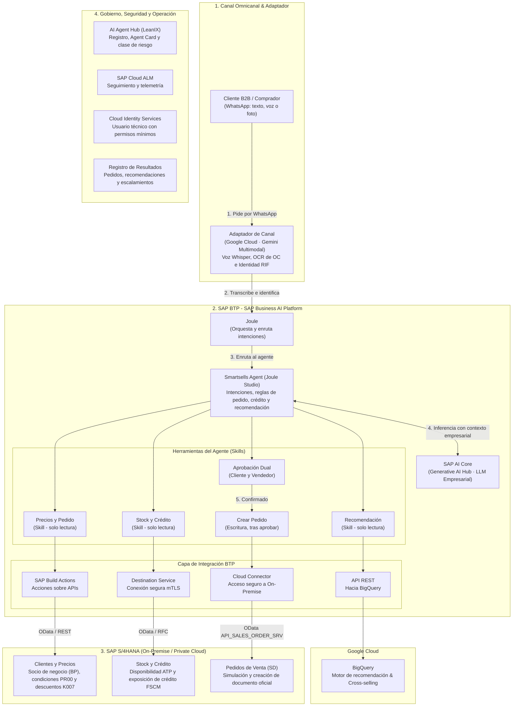

# 🏗️ Smartsells: Arquitectura de Integración SAP BTP & S/4HANA

Este documento formaliza la solución arquitectónica propuesta para **Smartsells**, diseñada para habilitar ventas conversacionales automatizadas e integradas en tiempo real con **SAP S/4HANA** y **Joule Studio** para grandes empresas en Venezuela.

---

## 1. Diagrama de la Arquitectura Propuesta

---

## 2. Flujo Operativo Paso a Paso (1 al 7)

1. **El cliente pide por WhatsApp**: El comprador corporativo envía su requerimiento por WhatsApp mediante audio ("*Mándame 30 bultos de harina y 10 cajas de aceite...*"), texto libre o foto/PDF de una orden de compra escaneada.
2. **El canal transcribe e identifica**: El adaptador en Google Cloud (Gemini Vision / Whisper) extrae los ítems estructurados, normaliza códigos y valida el número de teléfono contra el socio de negocio (Business Partner) y RIF de la empresa.
3. **Joule enruta al agente**: SAP Joule procesa la intención comercial y delega la sesión a **Smartsells Agent** en Joule Studio.
4. **El agente consulta y propone**:
   - Consulta el motor de recomendaciones en **BigQuery** para artículos complementarios.
   - Consulta **SAP Build Actions** para aplicar la lista de precios y condiciones contractuales (`PR00`, descuentos `K007`).
   - Verifica **Stock ATP** y **Límite de Crédito FSCM** vía Destination Service.
   - Presenta al cliente la cotización formal con desglose dual ($ USD y Bolívares a tasa oficial BCV).
5. **Confirman cliente y vendedor (Aprobación Dual)**: El comprador confirma en WhatsApp y, si el monto supera el umbral de crédito o margen, el vendedor de zona recibe la notificación de aprobación en el panel web.
6. **Crea el pedido en S/4HANA**: Con ambas aprobaciones registradas, el agente invoca el servicio OData `API_SALES_ORDER_SRV` a través del **SAP Cloud Connector**, generando el número oficial de pedido en SAP.
7. **Avisa la entrega y registra**: Notifica al cliente su número de pedido SAP y fecha estimada de despacho, al tiempo que registra la auditoría y telemetría en **SAP Cloud ALM** y **LeanIX**.

---

## 3. Matriz de Componentes y Responsabilidades

| Componente | Rol en la Solución | Protocolo / Tecnología |
| :--- | :--- | :--- |
| **Adaptador WhatsApp** | Recepción de webhooks de Meta, debounce y deduplicación | FastAPI, Redis, Cloudflare Tunnel |
| **Google Cloud Gemini** | Transcripción de audios (STT) y lectura de fotos/PDFs (OCR) | Gemini 1.5 / 2.0 Flash API |
| **SAP Joule / Joule Studio** | Orquestación conversacional, intenciones y lógica de negocio | SAP BTP Business AI |
| **SAP AI Core** | Generative AI Hub para inferencia segura con LLM empresarial | SAP AI Core Foundation |
| **BigQuery** | Motor de recomendación predictivo para reordenes y cross-selling | BigQuery REST API / Python Client |
| **SAP Build Actions** | Conectores declarativos de solo lectura sobre catálogos SAP | SAP Build Process Automation |
| **Destination Service** | Autenticación centralizada y propagación de identidad (IAS) | OAuth2, mTLS, SAML |
| **Cloud Connector** | Túnel cifrado reverso hacia la infraestructura S/4HANA On-Premise | SAP Cloud Connector Agent (TLS) |
| **SAP S/4HANA** | Core ERP: Módulos SD (Ventas), MM (Materiales) y FSCM (Crédito) | OData v2/v4 (`A_SalesOrder`, `A_BusinessPartner`) |
